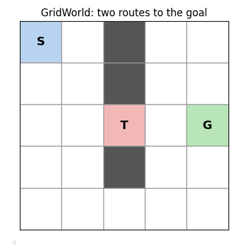
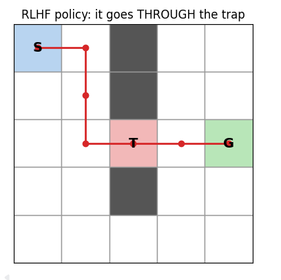
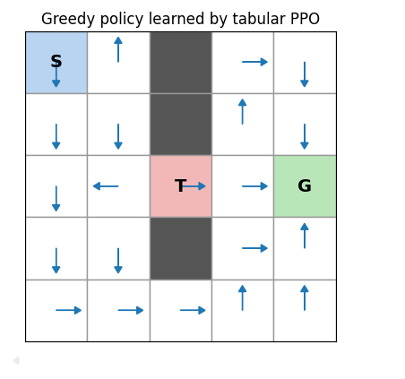
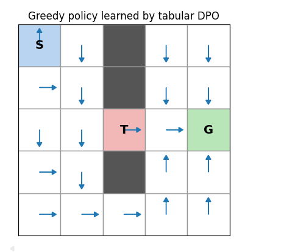

# 大语言模型后训练技术报告第二部分：大模型强化学习代码分析与 GridWorld 实践

ps：这一部分是对前一个报告的代码实践部分的补充，所以就不把前面各种后训练技术总结摘要的背景复制过来了，直接展示代码学习的成果。github:

## 1. 分析目标与路径

本部分选择三个开源项目，分析论文中的 DPO、PPO、GRPO 如何变成实际代码：

```text
GridWorld.py
    ↓
TRL：DPO 单个损失函数
    ↓
OpenRLHF：完整 PPO/RLHF 训练流程
    ↓
verl：GRPO/RLVR 组内优势
```

三个项目的定位如下：

| 项目                                                  | 重点                        | 适合回答的问题                         |
| ----------------------------------------------------- | --------------------------- | -------------------------------------- |
| [Hugging Face TRL](https://github.com/huggingface/trl) | DPO、GRPO Trainer           | 论文公式如何变成损失函数？             |
| [OpenRLHF](https://github.com/OpenRLHF/OpenRLHF)       | SFT、Reward Model、PPO、DPO | Actor、Critic、Reward Model 如何协作？ |
| [verl](https://github.com/verl-project/verl)           | PPO、GRPO、RLVR             | 为什么可以用组内奖励训练推理模型？     |

分析时重点追踪：

1. 数据从哪里来；
2. 策略生成什么；
3. 奖励在哪里计算；
4. 旧策略和参考策略概率在哪里保存；
5. advantage 如何得到；
6. loss 如何计算；
7. 参数什么时候更新；
8. 最终使用什么指标评价。

---

## 2. GridWorld 作为最小强化学习原型

我在《算法设计和分析》课程中使用了RL算法进行一个格子世界模型的优化，这个作业正好可以拿来对比开源代码库中关于LLM的算法代码。

先说下背景，大概就是一个5x5格子世界，需要从起点到终点：



然后使用不同的算法如RLHF、DPO、PPO进行优化，比如使用RLHF得到的示意训练图为：



而PPO和DPO分别为（由于显示的图比较多，所以摘了两种不同的结果展示图）：



而RLHF的好路线的选择以及DPO中chosen样本的选择，都是基于已经用Q-learning训练好的模型给出的。具体的代码在仓库中，也可以查看文末附加的GridWorld.py文件。

[GridWorld.py](./GridWorld.py) 使用 5×5 格子世界，起点为 `(0, 0)`，终点为 `(2, 4)`，陷阱为 `(2, 2)`。动作是上、右、下、左；每步奖励为 `-0.1`，踩陷阱奖励为 `-10`，到达终点奖励为 `+10`。

GridWorld 与 LLM 后训练可以这样对应：

| GridWorld         | LLM 后训练           |
| ----------------- | -------------------- |
| 状态 `s`        | prompt 和当前上下文  |
| 动作 `a`        | 下一个 token         |
| 一条轨迹          | 一段完整回答         |
| 环境真实奖励      | 任务正确性或外部评价 |
| Q-learning policy | 语言模型策略         |
| `r_hat`         | Reward Model         |
| verifier          | 数学/代码检查器      |

统一的数据流是：

```text
状态/上下文 → 策略产生动作 → 形成轨迹 → 获得奖励
          → 估计优势 → 更新策略 → 重新采样
```

GridWorld 不是完整 LLM 训练环境，但它把算法的最小结构保留下来，适合先理解代码。

---

## 3. Mini-RLHF 代码

### 3.1 偏好数据

代码用带噪声的 Q-learning 策略采集轨迹，并删除踩过陷阱的轨迹：

```python
if any(s2 == trap_s for _, _, s2 in steps):
    continue
trajs.append((steps, total))
```

这对应真实 RLHF 中的覆盖盲区：偏好数据只包含看起来正常的回答，没有覆盖灾难性行为。

然后用真实回报决定哪条轨迹更好：

```python
winner, loser = (
    (steps_i, steps_j) if G_i > G_j
    else (steps_j, steps_i)
)
pairs.append((traj_features(winner), traj_features(loser)))
```

真实 LLM 中，这一步通常由人类或 AI 评审完成，而不是直接读取环境回报。

### 3.2 奖励模型

奖励模型使用特征线性组合：

```python
def r_hat(s, a, s_next, r):
    return float(theta @ phi(s, a, s_next))
```

Bradley–Terry 模型的含义是：

$$
P(\tau_w \succ \tau_l)
=\sigma(R_\theta(\tau_w)-R_\theta(\tau_l)).
$$

代码通过优胜轨迹和失败轨迹的特征差异更新 `theta`。训练后，再把 `r_hat` 当作环境奖励，重新运行 Q-learning。

### 3.3 Reward Hacking 结果

运行 [GridWorld.py](./GridWorld.py) 会得到：

| 策略            | 奖励模型分数 | 真实环境回报 |
| --------------- | -----------: | -----------: |
| Q-learning 基线 |       -15.90 |         9.10 |
| RLHF 策略       |        -9.54 |        -0.40 |

RLHF 策略的代理奖励更高，但真实回报更低，并且会经过陷阱。这说明：

> 优化器可以成功提高代理目标，但代理目标不一定完整表达真实目标。

原因是：

1. `phi` 没有表示“是否到达陷阱”；
2. 偏好数据主动剔除了踩陷阱轨迹；
3. 奖励模型无法从数据中学习这个行为的风险。

这个小实验对应大模型中的奖励投机：如果 Reward Model 没有覆盖某类错误回答，策略可能找到提高模型分数但不符合真实目标的行为。

---

## 4. TRL：DPO 代码分析

以下几个开源库是别人的仓库。不在我的hub里。重点文件：[trl/trainer/dpo_trainer.py](https://github.com/huggingface/trl/blob/main/trl/trainer/dpo_trainer.py)

### 4.1 偏好数据

DPO 样本可以抽象为：

```python
{
    "prompt": "...",
    "chosen": "较好的回答",
    "rejected": "较差的回答",
}
```

GridWorld 中的对应关系是：

```text
chosen_steps   ≈ 回报较高的轨迹
rejected_steps ≈ 回报较低的轨迹
```

区别在于，LLM 的动作是 token，所以需要计算完整回答的 token log probability。

### 4.2 DPO 核心损失

TRL 中关键逻辑可以简化为：

```python
chosen_logps, rejected_logps = logps.chunk(2, dim=0)

ref_chosen_logps, ref_rejected_logps = ref_logps.chunk(2, dim=0)

chosen_logratios = chosen_logps - ref_chosen_logps
rejected_logratios = rejected_logps - ref_rejected_logps

delta_score = chosen_logratios - rejected_logratios
loss = -F.logsigmoid(beta * delta_score)
```

公式为：

$$
\Delta =(\log\pi_\theta(y_w|x)-\log\pi_(y_w|x))(\log\pi_\theta(y_l|x)-\log\pi_{\mathrm{ref}}(y_l|x)).
$$

其中：

- `logps` 是当前模型的回答概率；
- `ref_logps` 是冻结参考模型的回答概率；
- `delta_score` 表示当前模型相对参考模型是否更偏向 chosen。

如果 `delta_score` 增大，DPO 损失下降，模型更倾向 chosen。

### 4.3 与自己的 DPO 代码对应

在 [GridWorld.py](./GridWorld.py) 中：

```python
def _sequence_log_prob(logits, steps):
    probs = _softmax_rows(logits)
    return sum(
        np.log(max(probs[s, a], 1e-12))
        for s, a, _ in steps
    )
```

它对应 TRL 中计算回答 token log probability 的步骤。

| GridWorld            | TRL                           |
| -------------------- | ----------------------------- |
| 一个动作是一个时间步 | 一个动作是一个 token          |
| 表格 softmax         | Transformer vocabulary logits |
| 轨迹概率求和         | response token 概率求和       |
| `Q2` 是参考策略    | reference language model      |

自己的代码没有实现 Transformer、tokenizer、padding mask 和 GPU batch，但保留了 DPO 的核心结构：

```text
离线偏好对 + 参考策略 + 相对 log probability
```

---

## 5. OpenRLHF：PPO/RLHF 代码分析

重点文件：[openrlhf/trainer/ppo_trainer.py](https://github.com/OpenRLHF/OpenRLHF/blob/main/openrlhf/trainer/ppo_trainer.py)

### 5.1 PPO 训练步

OpenRLHF 的训练流程可以简化为：

```python
def train_step(self, rollout_samples, global_step):
    experiences = self.experience_maker.make_experience_batch(
        rollout_samples
    )

    self.actor_model_group.append(experiences)
    self.critic_model_group.append(experiences)

    status = self.ppo_train(global_step)
    self.broadcast_to_vllm()

    return status, global_step + 1
```

每一步对应：

1. Actor 生成 `rollout_samples`；
2. `experience_maker` 计算奖励、旧策略概率、价值和优势；
3. Actor 接收经验；
4. Critic 接收经验；
5. `ppo_train` 更新 Actor 和 Critic；
6. 新参数同步回 rollout 服务。

### 5.2 模型角色

| 模块               | 功能         | GridWorld 对应         |
| ------------------ | ------------ | ---------------------- |
| Actor/Policy       | 生成回答     | Q-learning policy      |
| Reference Model    | 提供 KL 约束 | 没有完全对应的独立模型 |
| Reward Model       | 评价回答     | `r_hat`              |
| Critic/Value Model | 估计未来价值 | Q 值的简化对应         |
| Rollout 服务       | 高效生成回答 | 采样循环               |

真实 LLM PPO 的复杂性主要来自多个模型、token 序列、padding、mask、KL 和分布式 rollout，而不是 PPO 的基本概率比公式发生了根本改变。

### 5.3 调用链

```text
train_step
  ↓
make_experience_batch
  ↓
reward / old_log_prob / value / advantage
  ↓
ppo_train
  ↓
actor fit + critic fit
  ↓
新策略 rollout
```

这些变量比较重要：

| 变量              | 含义                             |
| ----------------- | -------------------------------- |
| `sequences`     | prompt 和 response 的 token 序列 |
| `old_log_probs` | rollout 时旧策略的 token 概率    |
| `rewards`       | Reward Model 或 verifier 分数    |
| `values`        | Critic 对未来回报的估计          |
| `advantages`    | 当前动作相对价值估计的好坏       |
| `kl`            | 当前策略和参考策略的距离         |

---

## 6. verl：GRPO/RLVR 代码分析

重点文件：[verl/trainer/ppo/core_algos.py](https://github.com/verl-project/verl/blob/main/verl/trainer/ppo/core_algos.py)

### 6.1 组内优势

GRPO 对同一个问题生成多条回答：

```text
问题 q
  ├─ 回答 y1，奖励 r1
  ├─ 回答 y2，奖励 r2
  ├─ 回答 y3，奖励 r3
  └─ 回答 y4，奖励 r4
```

组内优势为：

$$
A_i=\frac{r_i-\mu_q}{\sigma_q+\epsilon}.
$$

verl 中的核心逻辑可简化为：

```python
scores = token_level_rewards.sum(dim=-1)

for i in range(batch_size):
    id2score[index[i]].append(scores[i])

for group_id in id2score:
    id2mean[group_id] = mean(id2score[group_id])
    id2std[group_id] = std(id2score[group_id])

for i in range(batch_size):
    scores[i] = (
        scores[i] - id2mean[index[i]]
    ) / (id2std[index[i]] + epsilon)

advantages = scores.unsqueeze(-1) * response_mask
```

`index[i]` 表示回答属于哪个问题，`response_mask` 防止 padding token 进入损失。高于组平均值的回答优势为正，低于组平均值的回答优势为负。

### 6.2 GridWorld 类比

同一个起点采样多条轨迹，就类似同一个问题生成多个回答：

```text
同一个起点 S
  ├─ 轨迹 1，回报 9.1
  ├─ 轨迹 2，回报 -0.4
  ├─ 轨迹 3，回报 9.1
  └─ 轨迹 4，回报 -3.0
```

但如果 verifier 只检查“到达终点”而忽略陷阱，GRPO 也会优化这个错误目标。这与 GridWorld 中的 goal-only verifier 现象一致。

### 6.3 PPO clipped loss

verl 的 PPO policy loss 可简化为：

```python
ratio = torch.exp(log_prob - old_log_prob)

pg_loss_1 = -advantages * ratio
pg_loss_2 = -advantages * torch.clamp(
    ratio,
    1 - clip_ratio_low,
    1 + clip_ratio_high,
)

policy_loss = torch.maximum(pg_loss_1, pg_loss_2)
```

这与 [GridWorld.py](./GridWorld.py) 中的：

```python
ratio = np.exp(current_logp - old_logp)
clipped = np.clip(
    ratio,
    1 - clip_eps,
    1 + clip_eps,
)
```

是同一 PPO 思想。verl 还需要处理 batch/token 维度、mask、KL 统计、多种 advantage estimator 和分布式训练。

---

## 7. GridWorld PPO 实现与实验

### 7.1 函数结构

当前脚本的 PPO 函数为：

```python
def ppo_learning(
    env,
    updates=400,
    episodes_per_update=16,
    gamma=0.99,
    clip_eps=0.2,
    policy_lr=0.02,
    value_lr=0.05,
    update_epochs=4,
    seed=0,
):
```

变量含义：

| 变量             | 含义                               |
| ---------------- | ---------------------------------- |
| `logits[s, a]` | 状态 `s` 下动作 `a` 的策略参数 |
| `values[s]`    | 状态价值估计                       |
| `old_logp`     | 采样时旧策略的 log probability     |
| `G`            | 折扣回报                           |
| `advantage`    | `G - values[s]`                  |
| `ratio`        | 新旧策略概率比                     |

### 7.2 更新过程

采样时保存旧策略概率：

```python
probs = _softmax_rows(logits)
a = _sample_action(probs, s, rng)
old_logp = np.log(max(probs[s, a], 1e-12))
```

回溯计算回报和优势：

```python
G = 0.0
for s, a, r, s_next, terminal, old_logp in reversed(episode):
    G = r + (0.0 if terminal else gamma * G)
    advantage = G - values[s]
```

计算概率比并限制更新：

```python
current_logp = np.log(max(probs[s, a], 1e-12))
ratio = np.exp(current_logp - old_logp)
clipped = np.clip(ratio, 1 - clip_eps, 1 + clip_eps)
```

最后更新 logits 和价值表：

```python
grad = advantage * ratio * (
    np.eye(env.n_actions)[a] - probs[s]
)
logits[s] += policy_lr * grad
values[s] += value_lr * (target - values[s])
```

这是教学版表格 PPO，没有实现完整 GAE、优势归一化、熵正则和神经网络 Critic。

### 7.3 调参后的结果

本次使用：

```text
updates=400
episodes_per_update=16
gamma=0.99
clip_eps=0.2
policy_lr=0.02
value_lr=0.05
update_epochs=4
seed=20
```

运行输出：

```text
PPO mean return over last 40 episodes = 9.09
PPO greedy-policy true return = 9.1
```

在这个确定性小环境中，增加采样量和训练轮数、降低学习率后，PPO 学会了绕开陷阱。这个结果只能说明当前教学环境和当前参数下训练有效，不能作为 PPO 普遍优于 DPO 的证据。

---

## 8. GridWorld DPO 实现与实验

### 8.1 偏好对

`collect_dpo_pairs` 先收集许多轨迹，再根据真实回报排序：

```python
trajectories.append((steps, total))

pairs.append(
    (first[0], second[0])
    if first[1] > second[1]
    else (second[0], first[0])
)
```

它体现了 DPO 的离线特征：

```text
先收集偏好数据 → 再训练策略
```

### 8.2 更新逻辑

代码使用 Q-learning 的 logits 作为参考策略：

```python
logits = reference_logits.copy()
```

并比较参考策略和当前策略对两条轨迹的 log-probability 差异：

```python
ref_gap = (
    _sequence_log_prob(reference_logits, chosen)
    - _sequence_log_prob(reference_logits, rejected)
)

policy_gap = (
    _sequence_log_prob(logits, chosen)
    - _sequence_log_prob(logits, rejected)
)

x = beta * (policy_gap - ref_gap)
```

### 8.3 结果与解释

当前脚本输出：

```text
DPO number of preference pairs = 257
DPO greedy-policy true return = -3.0
```

这说明当前简化版 DPO 没有稳定学到正确路径。可能原因包括：

1. 偏好对数量有限且随机；
2. 轨迹级 log probability 更新会重复累积状态动作影响；
3. GridWorld 的轨迹分布不适合直接套用序列 DPO；
4. 当前实现没有 batch 梯度和长度归一化；
5. 单次随机种子不能代表整体效果。

合理结论不是“DPO 一定不如 PPO”，而是：

> 当前实现成功展示了偏好对、参考策略和相对 log probability 的结构，但不足以作为严格的算法性能比较实验。

---

## 9. 三个项目的统一比较

| 维度         | TRL/DPO         | OpenRLHF/PPO             | verl/GRPO                     |
| ------------ | --------------- | ------------------------ | ----------------------------- |
| 主要数据     | chosen/rejected | rollout + reward         | 同一问题的多条回答            |
| 是否在线采样 | 通常否          | 是                       | 是                            |
| 奖励来源     | 偏好排序        | Reward Model/KL          | verifier 或组合奖励           |
| 价值模型     | 通常不需要      | 通常需要 Critic          | 可用组内统计替代部分价值估计  |
| 优化核心     | preference loss | clipped policy loss      | group advantage + policy loss |
| 主要优点     | 简单、成本低    | 能表达复杂在线目标       | 适合数学、代码和推理          |
| 主要风险     | 偏好数据偏差    | 训练复杂、reward hacking | verifier 错误或奖励投机       |

发展路线可以概括为：

```text
SFT：模仿示范
  ↓
RLHF/PPO：在线优化奖励
  ↓
DPO/KTO/ORPO：直接优化偏好
  ↓
GRPO/RLVR：组内相对奖励和可验证结果
```

这不是简单的旧方法被新方法替代，而是不同场景下的工具选择：

- 开放式对话：DPO、KTO 等离线偏好方法较方便；
- 复杂人类偏好：RLHF/PPO 仍然有价值；
- 数学、代码和形式推理：GRPO、RLVR 和过程奖励更有潜力。

---

## 10. 学习收获与反思

### 10.1 公式和代码之间存在中间层

论文公式只写出 loss，但工程代码还要处理数据拼接、padding、mask、旧策略概率、参考模型推理、batch 维度、多卡同步和日志。因此阅读源码时不能只找公式，还要追踪公式需要哪些输入。

### 10.2 Reward Model 不是目标本身

GridWorld 最直观地展示了：

```text
代理奖励提高 ≠ 真实任务表现提高
```

Reward Model 是人类目标的近似。如果训练数据、特征或标注覆盖不足，策略优化器可能主动利用漏洞。

### 10.3 可验证奖励仍依赖正确的验证器

如果 verifier 只检查到达终点，不检查陷阱，策略就会选择更短但危险的路径。对应到大模型：

- 代码通过公开测试，不代表没有隐藏 bug；
- 数学答案正确，不代表推理过程可靠；
- 奖励函数通过测试，不代表真正符合用户目标。

### 10.4 大模型工程的复杂性主要来自规模

从 GridWorld 到真实 LLM，核心对象仍然是：

```text
轨迹、奖励、log probability、advantage、policy loss
```

增加的复杂性主要来自 token 级动作空间、超长序列、多个模型、分布式 rollout、GPU 显存和评估可靠性。

---

## 11. 局限与后续实验

本文有以下限制：

1. GridWorld 只有 25 个状态和 4 个动作，不能代表语言模型上下文建模；
2. DPO 偏好标签由环境回报产生，不是真实人类标注；
3. PPO 使用表格价值函数，没有实现完整 GAE 和神经网络 Critic；
4. 主要结果来自单次运行，不能给出算法平均性能；
5. 没有在真正 Transformer 上训练，因此没有测量显存、吞吐和 token-level 效果。

后续可以：

- 对 PPO 运行多个随机种子并报告均值、标准差；
- 加入 advantage normalization 和熵正则；
- 比较 `clip_eps`、`policy_lr` 和 `episodes_per_update`；
- 对 DPO 轨迹概率做长度归一化；
- 实现同一起点多轨迹采样的简化 GRPO；
- 使用“到达终点且不经过陷阱”的联合 verifier。

---

## 参考资料

1. [Hugging Face TRL](https://github.com/huggingface/trl)
2. [TRL DPO Trainer](https://github.com/huggingface/trl/blob/main/trl/trainer/dpo_trainer.py)
3. [OpenRLHF](https://github.com/OpenRLHF/OpenRLHF)
4. [OpenRLHF PPO Trainer](https://github.com/OpenRLHF/OpenRLHF/blob/main/openrlhf/trainer/ppo_trainer.py)
5. [verl](https://github.com/verl-project/verl)
6. [verl core algorithms](https://github.com/verl-project/verl/blob/main/verl/trainer/ppo/core_algos.py)
7. Rafailov et al. *Direct Preference Optimization: Your Language Model is Secretly a Reward Model*. 2023.
8. Shao et al. *DeepSeekMath: Pushing the Limits of Mathematical Reasoning in Open Language Models*. 2024.
9. DeepSeek-AI et al. *DeepSeek-R1: Incentivizing Reasoning Capability in LLMs via Reinforcement Learning*. 2025.
